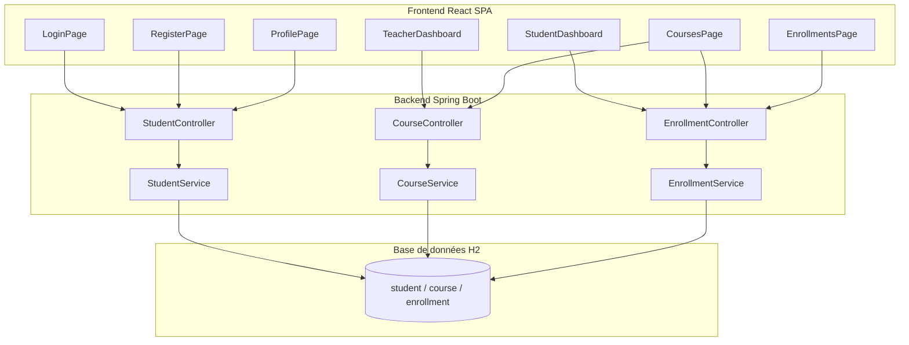
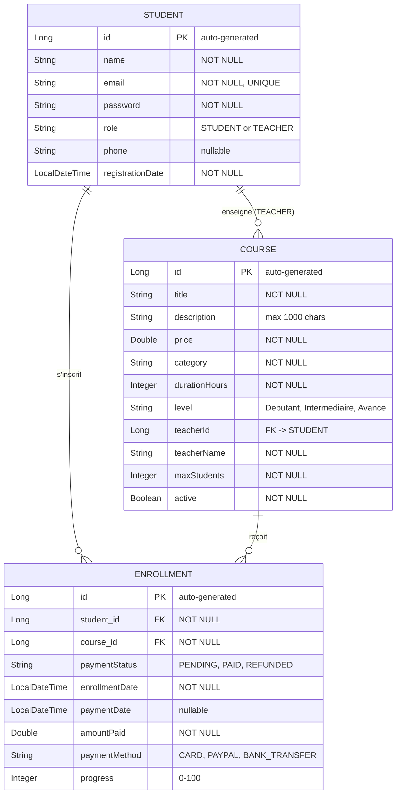
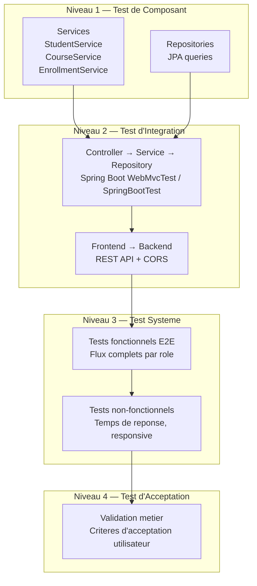
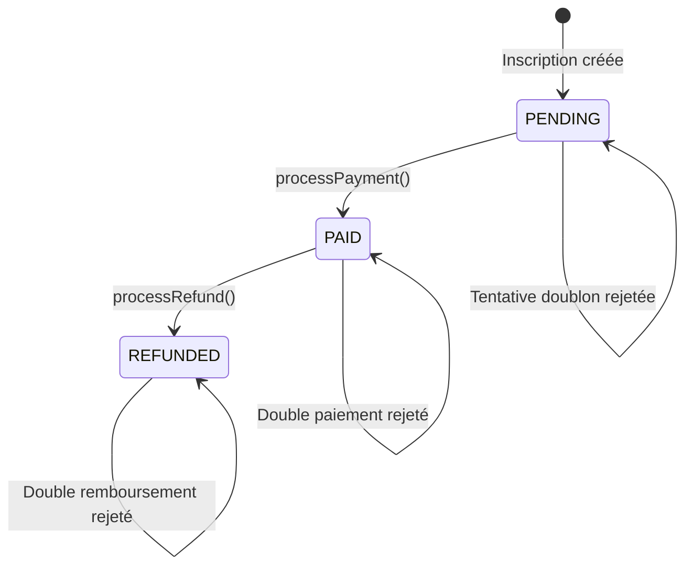
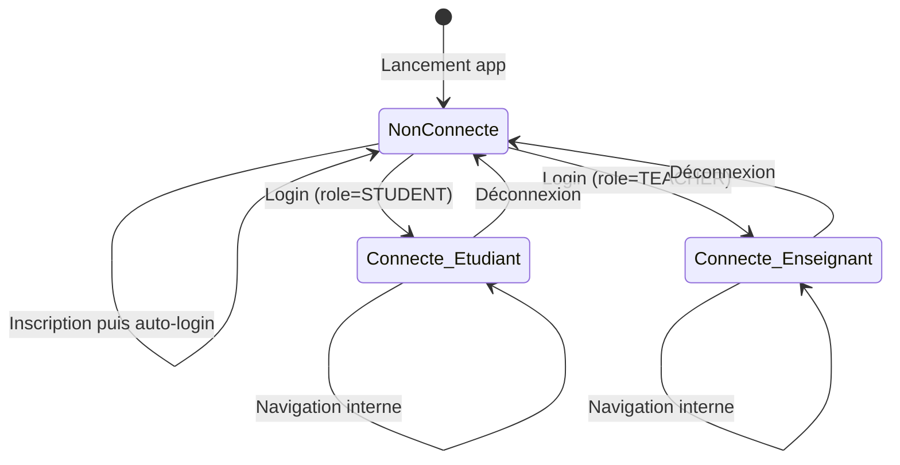

# Plan de Test — EduEnroll v2.0

**Identifiant** : TP-EDUENROLL-002  
**Version** : 2.0  
**Date** : 2026-09-29  
**Statut** : Draft  
**Conforme à** : ISO/IEC/IEEE 29119-3:2021 — Clause 9 (Test Plan) · ISTQB Foundation Syllabus v4.0  

---

## 1. Introduction

### 1.1 Objectif du document

Ce Plan de Test définit la portée, l'approche, les ressources et le calendrier des activités de test pour l'application **EduEnroll v2.0** — plateforme complète d'inscription d'étudiants à des cours en ligne, avec authentification, gestion des cours par les enseignants, paiement et zones dédiées (étudiant / enseignant).

Le document est structuré conformément à la clause 9 de l'**ISO/IEC/IEEE 29119-3:2021** et utilise la terminologie définie dans le **Glossaire ISTQB v4.0**.

### 1.2 Portée du document

Ce plan couvre les niveaux de test suivants :
- **Test unitaire** (test de composant)
- **Test d'intégration** (test d'intégration de composants)
- **Test système** (test fonctionnel et non-fonctionnel)
- **Test d'acceptation** (test d'acceptation utilisateur)

### 1.3 Références

| Réf. | Document |
|------|----------|
| REF-01 | ISTQB Certified Tester Foundation Level Syllabus v4.0 (2023) |
| REF-02 | ISO/IEC/IEEE 29119-3:2021 — Test Documentation |
| REF-03 | ISO/IEC/IEEE 29119-4:2021 — Test Techniques |
| REF-04 | [pom.xml](file:///c:/Users/mohni/Desktop/test%20programme/backend/pom.xml) — Dépendances backend |
| REF-05 | [application.properties](file:///c:/Users/mohni/Desktop/test%20programme/backend/src/main/resources/application.properties) — Configuration serveur |
| REF-06 | [data.sql](file:///c:/Users/mohni/Desktop/test%20programme/backend/src/main/resources/data.sql) — Données seed |

### 1.4 Historique des versions

| Version | Date | Auteur | Description |
|---------|------|--------|-------------|
| 1.0 | 2026-09-22 | Test Manager | Version initiale (application minimale) |
| 2.0 | 2026-09-29 | Test Manager | Refonte complète — ajout authentification, rôles, zones dédiées, paiement avec méthode, remboursement, gestion des cours par les enseignants, profil utilisateur |

---

## 2. Contexte & Objet de Test

### 2.1 Description de l'application

EduEnroll v2.0 est une application multiservice de gestion d'inscriptions aux cours en ligne, composée de :

| Composant | Technologie | Rôle |
|-----------|-------------|------|
| Backend API | Spring Boot 3.2.5 / Java 17 | API REST, logique métier, persistance, authentification |
| Frontend | React 19 / Vite | Interface utilisateur SPA avec routage authentifié |
| Base de données | H2 (in-memory) | Stockage des données (3 tables : student, course, enrollment) |

### 2.2 Architecture fonctionnelle



### 2.3 Éléments de test (Test Items)

| ID | Élément de test | Version | Source |
|----|-----------------|---------|--------|
| TI-01 | [StudentController](file:///c:/Users/mohni/Desktop/test%20programme/backend/src/main/java/com/enrollment/controller/StudentController.java) | 2.0 | Backend |
| TI-02 | [CourseController](file:///c:/Users/mohni/Desktop/test%20programme/backend/src/main/java/com/enrollment/controller/CourseController.java) | 2.0 | Backend |
| TI-03 | [EnrollmentController](file:///c:/Users/mohni/Desktop/test%20programme/backend/src/main/java/com/enrollment/controller/EnrollmentController.java) | 2.0 | Backend |
| TI-04 | [StudentService](file:///c:/Users/mohni/Desktop/test%20programme/backend/src/main/java/com/enrollment/service/StudentService.java) | 2.0 | Backend |
| TI-05 | [CourseService](file:///c:/Users/mohni/Desktop/test%20programme/backend/src/main/java/com/enrollment/service/CourseService.java) | 2.0 | Backend |
| TI-06 | [EnrollmentService](file:///c:/Users/mohni/Desktop/test%20programme/backend/src/main/java/com/enrollment/service/EnrollmentService.java) | 2.0 | Backend |
| TI-07 | [LoginPage](file:///c:/Users/mohni/Desktop/test%20programme/frontend/src/pages/LoginPage.jsx) | 2.0 | Frontend |
| TI-08 | [RegisterPage](file:///c:/Users/mohni/Desktop/test%20programme/frontend/src/pages/RegisterPage.jsx) | 2.0 | Frontend |
| TI-09 | [StudentDashboard](file:///c:/Users/mohni/Desktop/test%20programme/frontend/src/pages/StudentDashboard.jsx) | 2.0 | Frontend |
| TI-10 | [TeacherDashboard](file:///c:/Users/mohni/Desktop/test%20programme/frontend/src/pages/TeacherDashboard.jsx) | 2.0 | Frontend |
| TI-11 | [CoursesPage](file:///c:/Users/mohni/Desktop/test%20programme/frontend/src/pages/CoursesPage.jsx) | 2.0 | Frontend |
| TI-12 | [EnrollmentsPage](file:///c:/Users/mohni/Desktop/test%20programme/frontend/src/pages/EnrollmentsPage.jsx) | 2.0 | Frontend |
| TI-13 | [ProfilePage](file:///c:/Users/mohni/Desktop/test%20programme/frontend/src/pages/ProfilePage.jsx) | 2.0 | Frontend |
| TI-14 | [API Module](file:///c:/Users/mohni/Desktop/test%20programme/frontend/src/api/api.js) | 2.0 | Frontend |
| TI-15 | [App (Routing + Auth)](file:///c:/Users/mohni/Desktop/test%20programme/frontend/src/App.jsx) | 2.0 | Frontend |

### 2.4 Modèle de données



---

## 3. Fonctionnalités à Tester / Hors Périmètre

### 3.1 Fonctionnalités dans le périmètre (Features to be Tested)

| ID | Fonctionnalité | Module | Priorité |
|----|----------------|--------|----------|
| F-01 | Création d'un compte (inscription) avec choix du rôle (étudiant/enseignant) | Auth | Haute |
| F-02 | Unicité de l'email (contrainte métier) | Auth | Haute |
| F-03 | Connexion (login) par email et mot de passe | Auth | Haute |
| F-04 | Déconnexion et persistance de session (localStorage) | Auth | Haute |
| F-05 | Routage conditionnel selon le rôle (étudiant vs enseignant) | Auth | Haute |
| F-06 | Dashboard étudiant (statistiques : cours inscrits, payés, en attente, progression) | Étudiant | Moyenne |
| F-07 | Consultation du catalogue de cours avec filtres (catégorie, niveau) | Cours | Moyenne |
| F-08 | Inscription d'un étudiant à un cours | Inscription | Haute |
| F-09 | Prévention de la double inscription (même étudiant, même cours) | Inscription | Haute |
| F-10 | Vérification de la capacité maximale d'un cours | Inscription | Haute |
| F-11 | Vérification que le cours est actif avant inscription | Inscription | Moyenne |
| F-12 | Paiement avec sélection de la méthode (carte, PayPal, virement) | Paiement | Haute |
| F-13 | Prévention du double paiement | Paiement | Haute |
| F-14 | Remboursement d'un paiement effectué | Paiement | Haute |
| F-15 | Prévention du remboursement d'un paiement non effectué | Paiement | Moyenne |
| F-16 | Suivi de la progression d'un cours (0-100%) | Étudiant | Moyenne |
| F-17 | Dashboard enseignant (statistiques : cours, étudiants, revenus) | Enseignant | Moyenne |
| F-18 | Création d'un cours par un enseignant | Enseignant | Haute |
| F-19 | Modification d'un cours existant | Enseignant | Moyenne |
| F-20 | Suppression d'un cours | Enseignant | Moyenne |
| F-21 | Consultation de la liste des étudiants inscrits à un cours (vue enseignant) | Enseignant | Moyenne |
| F-22 | Activation/désactivation d'un cours | Enseignant | Moyenne |
| F-23 | Mise à jour du profil utilisateur (nom, email, téléphone, mot de passe) | Profil | Moyenne |
| F-24 | Validation que seuls les enseignants peuvent créer des cours | Auth/Rôle | Haute |
| F-25 | Affichage des messages de succès et d'erreur (UI feedback) | UI | Moyenne |
| F-26 | Navigation entre les pages avec barre de navigation adaptée au rôle | UI | Moyenne |
| F-27 | Communication Frontend ↔ Backend (intégration REST/CORS) | Intégration | Haute |

### 3.2 Fonctionnalités hors périmètre (Features not to be Tested)

| Fonctionnalité | Justification |
|----------------|---------------|
| Hachage des mots de passe (bcrypt) | Non implémenté — mots de passe stockés en clair (contexte testing) |
| Authentification par token (JWT) | Non implémenté — session côté client via localStorage |
| Paiement réel (Stripe, PayPal) | Simulation uniquement — changement de statut en base |
| Upload d'images/documents | Non implémenté |
| Performance / Charge | Application pour cours de testing, pas de SLA |
| Accessibilité (WCAG 2.1) | Hors scope pour cette itération |
| Internationalisation (i18n) | Interface uniquement en français |
| Sécurité avancée (injection SQL, XSS, CSRF) | H2 en mémoire, pas de données sensibles en production |

---

## 4. Approche de Test (Test Approach)

### 4.1 Niveaux de test



### 4.2 Types de test

| Type de test | Applicable | Technique(s) associée(s) |
|--------------|-----------|--------------------------|
| Test fonctionnel | Oui | Partitions d'équivalence, Valeurs limites, Tables de décision, Transitions d'état |
| Test non-fonctionnel | Partiel | Temps de réponse API (< 500ms), responsive design |
| Test boîte blanche | Oui | Couverture d'instructions, couverture de branches |
| Test de confirmation (re-test) | Oui | Vérification des défauts corrigés |
| Test de régression | Oui | Ré-exécution de la suite après correction |

### 4.3 Techniques de conception de test (ISO/IEC/IEEE 29119-4)

#### 4.3.1 Partitions d'équivalence (Equivalence Partitioning)

**Module Authentification — Login :**

| Partition | Classe | Validité | Exemple |
|-----------|--------|----------|---------|
| EP-01 | Email existant + mot de passe correct | Valide | `marie.laurent@eduenroll.com` / `teacher123` |
| EP-02 | Email existant + mot de passe incorrect | Invalide | `marie.laurent@eduenroll.com` / `wrong` |
| EP-03 | Email inexistant | Invalide | `unknown@email.com` / `any` |
| EP-04 | Email vide | Invalide | `""` / `pass123` |

**Module Authentification — Inscription :**

| Partition | Classe | Validité | Exemple |
|-----------|--------|----------|---------|
| EP-05 | Données valides, email unique, rôle STUDENT | Valide | `{name: "Jean", email: "jean@test.com", password: "pass123", role: "STUDENT"}` |
| EP-06 | Données valides, email unique, rôle TEACHER | Valide | `{..., role: "TEACHER"}` |
| EP-07 | Email déjà existant | Invalide | `{email: "marie.laurent@eduenroll.com", ...}` |
| EP-08 | Email avec format invalide | Invalide | `jean@`, `@email.com`, `jean` |
| EP-09 | Champs obligatoires vides | Invalide | `{name: "", email: "", password: ""}` |

**Module Inscription aux cours :**

| Partition | Classe | Validité |
|-----------|--------|----------|
| EP-10 | IDs existants, pas déjà inscrit, cours actif, places disponibles | Valide |
| EP-11 | `studentId` inexistant | Invalide |
| EP-12 | `courseId` inexistant | Invalide |
| EP-13 | Combinaison déjà inscrite | Invalide |
| EP-14 | Cours complet (maxStudents atteint) | Invalide |
| EP-15 | Cours inactif | Invalide |

**Module Paiement :**

| Partition | Classe | Validité |
|-----------|--------|----------|
| EP-16 | Enrollment PENDING + méthode CARD | Valide |
| EP-17 | Enrollment PENDING + méthode PAYPAL | Valide |
| EP-18 | Enrollment PENDING + méthode BANK_TRANSFER | Valide |
| EP-19 | Enrollment déjà PAID | Invalide |
| EP-20 | Enrollment ID inexistant | Invalide |

**Module Remboursement :**

| Partition | Classe | Validité |
|-----------|--------|----------|
| EP-21 | Enrollment PAID | Valide |
| EP-22 | Enrollment PENDING | Invalide |
| EP-23 | Enrollment REFUNDED | Invalide |

**Module Progression :**

| Partition | Classe | Validité |
|-----------|--------|----------|
| EP-24 | Valeur entre 0 et 100 | Valide |
| EP-25 | Valeur < 0 | Invalide |
| EP-26 | Valeur > 100 | Invalide |

#### 4.3.2 Analyse des valeurs limites (Boundary Value Analysis)

| Champ | Limite | Valeur limite | Test |
|-------|--------|---------------|------|
| `name` | Longueur min | 1 caractère | Valide |
| `name` | Vide | 0 caractère | Invalide |
| `password` | Longueur min (frontend) | 4 caractères | Valide (min) |
| `password` | Sous la limite | 3 caractères | Invalide |
| `description` | Longueur max | 1000 caractères | Valide (max) |
| `description` | Au-delà max | 1001 caractères | Invalide |
| `price` | Positif | 0.01 | Valide (min) |
| `price` | Zéro | 0.00 | Cas limite |
| `price` | Négatif | -1.00 | Invalide |
| `progress` | Borne inférieure | 0 | Valide |
| `progress` | Borne supérieure | 100 | Valide |
| `progress` | Sous borne | -1 | Invalide |
| `progress` | Au-delà borne | 101 | Invalide |
| `maxStudents` | Min | 1 | Valide |
| `maxStudents` | Zéro | 0 | Invalide |
| `durationHours` | Min | 1 | Valide |

#### 4.3.3 Tables de décision (Decision Tables)

**Authentification (Login) :**

| | R1 | R2 | R3 | R4 |
|---|---|---|---|---|
| **Conditions** | | | | |
| Email existe ? | Oui | Oui | Non | — |
| Password correct ? | Oui | Non | — | — |
| Champs remplis ? | Oui | Oui | Oui | Non |
| **Actions** | | | | |
| Connexion réussie (200) | ✅ | | | |
| Erreur "Email ou mot de passe incorrect" (401) | | ✅ | ✅ | |
| Validation HTML5 bloque soumission | | | | ✅ |

**Inscription d'un étudiant à un cours :**

| | R1 | R2 | R3 | R4 | R5 | R6 |
|---|---|---|---|---|---|---|
| **Conditions** | | | | | | |
| Étudiant existe ? | Oui | Non | Oui | Oui | Oui | Oui |
| Cours existe ? | Oui | — | Non | Oui | Oui | Oui |
| Déjà inscrit ? | Non | — | — | Oui | Non | Non |
| Cours actif ? | Oui | — | — | — | Non | Oui |
| Places disponibles ? | Oui | — | — | — | — | Non |
| **Actions** | | | | | | |
| Enrollment créé (201) | ✅ | | | | | |
| Erreur "Étudiant non trouvé" (400) | | ✅ | | | | |
| Erreur "Cours non trouvé" (400) | | | ✅ | | | |
| Erreur "Déjà inscrit" (400) | | | | ✅ | | |
| Erreur "Cours non disponible" (400) | | | | | ✅ | |
| Erreur "Cours complet" (400) | | | | | | ✅ |

**Traitement du paiement :**

| | R1 | R2 | R3 | R4 |
|---|---|---|---|---|
| **Conditions** | | | | |
| Enrollment existe ? | Oui | Non | Oui | Oui |
| Statut = PENDING ? | Oui | — | Non (PAID) | Non (REFUNDED) |
| Méthode fournie ? | Oui | — | — | — |
| **Actions** | | | | |
| Statut → PAID (200) | ✅ | | | |
| Erreur "Inscription non trouvée" (400) | | ✅ | | |
| Erreur "Déjà payé" (400) | | | ✅ | ✅ |

**Création de cours (enseignant) :**

| | R1 | R2 | R3 |
|---|---|---|---|
| **Conditions** | | | |
| Utilisateur est TEACHER ? | Oui | Non | Oui |
| Champs obligatoires remplis ? | Oui | — | Non |
| **Actions** | | | |
| Cours créé (201) | ✅ | | |
| Erreur "Seuls les enseignants" (400) | | ✅ | |
| Validation bloque soumission | | | ✅ |

#### 4.3.4 Diagramme de transition d'état (State Transition)

**Statut de paiement :**



**Session utilisateur :**



### 4.4 Stratégie d'Automatisation des Tests

Conformément à l'ISTQB (Syllabus v4.0, Chapitre 5 — « Gestion des tests »), le Plan de Test doit définir **l'approche d'automatisation** : quels tests sont automatisés, avec quels outils, et à quel niveau.

#### 4.4.1 Niveaux d'automatisation

| Niveau de test | Type d'automatisation | Outil / Framework | Justification |
|----------------|----------------------|-------------------|---------------|
| **Test unitaire (composant)** | Automatisé | **JUnit 5** + **Mockito** | Tests des services métier isolés (StudentService, CourseService, EnrollmentService). Exécution rapide, intégrés au build Maven (`mvn test`). |
| **Test d'intégration API** | Automatisé | **Spring Boot Test** + **MockMvc** / **TestRestTemplate** | Tests des controllers REST avec contexte Spring complet ou partiel (@WebMvcTest, @SpringBootTest). Validation des codes HTTP, corps de réponse JSON. |
| **Test d'intégration Frontend** | Automatisé | **Cypress** (recommandé) ou **Playwright** | Tests E2E simulant les interactions utilisateur réelles dans un navigateur. Validation du flux complet : login → navigation → actions → résultats UI. |
| **Test système UI** | Semi-automatisé | **Cypress** / **Playwright** + tests manuels exploratoires | Les scénarios E2E principaux (TC-E2E-001, TC-E2E-002) sont automatisés. Les tests exploratoires restent manuels. |
| **Test d'acceptation** | Manuel | Exécution manuelle avec checklist | Validation métier avec les parties prenantes. |

#### 4.4.2 Choix de l'outil d'automatisation frontend

Trois outils majeurs sont évalués selon les critères ISTQB (facilité d'adoption, maintenance, fiabilité, coût) :

| Critère | Cypress | Playwright | Selenium WebDriver |
|---------|---------|------------|--------------------|
| **Langage de script** | JavaScript/TypeScript | JavaScript/TypeScript, Python, Java, C# | Java, Python, JavaScript, C#, Ruby |
| **Installation** | `npm install cypress --save-dev` | `npm install @playwright/test --save-dev` | Nécessite driver séparé (ChromeDriver, GeckoDriver) |
| **Vitesse d'exécution** | Rapide (exécution in-browser) | Très rapide (protocole CDP) | Plus lent (communication WebDriver) |
| **Support multi-navigateurs** | Chrome, Edge, Firefox | Chromium, Firefox, WebKit (Safari) | Tous les navigateurs majeurs |
| **Attentes automatiques (auto-wait)** | Oui (natif) | Oui (natif) | Non (waits explicites requis) |
| **Capture vidéo/screenshots** | Oui (natif) | Oui (natif) | Via configuration externe |
| **Debugging** | Time-travel debugging, GUI | Trace viewer, VS Code extension | Logs, screenshots manuels |
| **Courbe d'apprentissage** | Facile | Facile-Moyen | Moyen-Difficile |
| **Intégration CI/CD** | GitHub Actions, GitLab CI, Jenkins | GitHub Actions, GitLab CI, Jenkins | Jenkins, Selenium Grid |
| **Recommandation** | **Recommandé pour ce projet** | Alternative solide | Adapté pour projets Java-centric |

> **Décision** : **Cypress** est recommandé comme outil principal d'automatisation E2E pour EduEnroll v2.0, en raison de sa facilité d'installation (même stack JavaScript que le frontend React), de son debugging intuitif, et de ses attentes automatiques qui réduisent les tests instables (flaky tests).

#### 4.4.3 Architecture des tests automatisés

```
test programme/
├── backend/
│   └── src/test/java/com/enrollment/
│       ├── service/                        ← Tests unitaires (JUnit 5 + Mockito)
│       │   ├── StudentServiceTest.java
│       │   ├── CourseServiceTest.java
│       │   └── EnrollmentServiceTest.java
│       ├── controller/                     ← Tests d'intégration API (MockMvc)
│       │   ├── StudentControllerTest.java
│       │   ├── CourseControllerTest.java
│       │   └── EnrollmentControllerTest.java
│       └── integration/                    ← Tests d'intégration complète (SpringBootTest)
│           └── FullIntegrationTest.java
├── frontend/
│   └── cypress/                            ← Tests E2E automatisés (Cypress)
│       ├── e2e/
│       │   ├── auth.cy.js                  ← TC-AUTH (login, register, déconnexion)
│       │   ├── student-flow.cy.js          ← TC-E2E-001 (flux étudiant complet)
│       │   ├── teacher-flow.cy.js          ← TC-E2E-002 (flux enseignant complet)
│       │   ├── courses.cy.js               ← TC-CRS (catalogue, filtres)
│       │   ├── enrollments.cy.js           ← TC-ENR + TC-PAY (inscription, paiement)
│       │   └── profile.cy.js              ← TC-PRF (profil utilisateur)
│       ├── support/
│       │   ├── commands.js                 ← Commandes personnalisées (cy.login(), cy.resetDB())
│       │   └── e2e.js                      ← Configuration globale
│       └── fixtures/
│           └── users.json                  ← Données de test (comptes démo)
```

#### 4.4.4 Exemples de scripts de test automatisé

**Exemple 1 — Test unitaire backend (JUnit 5 + Mockito) :**

```java
@ExtendWith(MockitoExtension.class)
class StudentServiceTest {
    @Mock private StudentRepository studentRepository;
    @InjectMocks private StudentService studentService;

    @Test
    @DisplayName("TC-AUTH-003 : Rejeter un email en doublon")
    void shouldRejectDuplicateEmail() {
        // Arrange
        when(studentRepository.findByEmail("alice@test.com"))
            .thenReturn(Optional.of(new Student()));
        Student newStudent = new Student();
        newStudent.setEmail("alice@test.com");

        // Act & Assert
        assertThrows(RuntimeException.class,
            () -> studentService.register(newStudent));
        verify(studentRepository, never()).save(any());
    }
}
```

**Exemple 2 — Test d'intégration API (MockMvc) :**

```java
@SpringBootTest
@AutoConfigureMockMvc
class StudentControllerIntegrationTest {
    @Autowired private MockMvc mockMvc;

    @Test
    @DisplayName("TC-AUTH-004 : Login avec identifiants valides")
    void shouldLoginWithValidCredentials() throws Exception {
        mockMvc.perform(post("/api/students/login")
                .param("email", "marie.laurent@eduenroll.com")
                .param("password", "teacher123"))
            .andExpect(status().isOk())
            .andExpect(jsonPath("$.name").value("Marie Laurent"))
            .andExpect(jsonPath("$.role").value("TEACHER"));
    }
}
```

**Exemple 3 — Test E2E frontend (Cypress) :**

```javascript
// cypress/e2e/auth.cy.js
describe('Module Authentification', () => {
  beforeEach(() => {
    cy.visit('http://localhost:5173');
  });

  it('TC-AUTH-004 : Login enseignant avec identifiants valides', () => {
    cy.get('#login-email').type('marie.laurent@eduenroll.com');
    cy.get('#login-password').type('teacher123');
    cy.get('button[type="submit"]').click();
    cy.contains('Espace Enseignant').should('be.visible');
    cy.contains('Marie Laurent').should('be.visible');
  });

  it('TC-AUTH-005 : Login avec mot de passe incorrect', () => {
    cy.get('#login-email').type('marie.laurent@eduenroll.com');
    cy.get('#login-password').type('wrongpassword');
    cy.get('button[type="submit"]').click();
    cy.get('.alert-error').should('be.visible');
  });

  it('TC-E2E-001 : Flux complet etudiant', () => {
    // Inscription
    cy.contains('Creer un compte').click();
    cy.get('#reg-name').type('Ahmed Test');
    cy.get('#reg-email').type('ahmed.test@email.com');
    cy.get('#reg-password').type('secure123');
    cy.get('button[type="submit"]').click();
    cy.get('.alert-success').should('be.visible');

    // Dashboard
    cy.contains('Bonjour, Ahmed').should('be.visible');

    // Catalogue
    cy.contains('Cours').click();
    cy.get('.course-card').should('have.length.greaterThan', 0);

    // Inscription a un cours
    cy.get('.course-card').first().find('button').contains("S'inscrire").click();
    cy.get('.alert-success').should('be.visible');
  });
});
```

**Exemple 4 — Alternative avec Playwright :**

```javascript
// tests/auth.spec.js
import { test, expect } from '@playwright/test';

test('TC-AUTH-004 : Login enseignant', async ({ page }) => {
  await page.goto('http://localhost:5173');
  await page.fill('#login-email', 'marie.laurent@eduenroll.com');
  await page.fill('#login-password', 'teacher123');
  await page.click('button[type="submit"]');
  await expect(page.locator('text=Espace Enseignant')).toBeVisible();
});
```

#### 4.4.5 Critères d'automatisation

Conformément aux bonnes pratiques ISTQB, les tests suivants sont prioritaires pour l'automatisation :

| Critère | Tests concernés | Raison |
|---------|----------------|--------|
| Tests de régression | TC-AUTH-001 à TC-AUTH-006, TC-ENR-001, TC-PAY-001 | Exécutés à chaque modification de code |
| Tests répétitifs | TC-E2E-001, TC-E2E-002 | Scénarios longs exécutés à chaque itération |
| Tests à données multiples | TC-PAY-001/002/003 (3 méthodes de paiement) | Même logique, données différentes |
| Tests de validation métier critique | TC-ENR-002 (doublon), TC-PAY-004 (double paiement), TC-CRS-006 (rôle) | Impact financier ou sécurité |

Les tests suivants restent **manuels** :

| Type | Raison |
|------|--------|
| Tests exploratoires | Nécessitent un jugement humain |
| Tests d'acceptation utilisateur | Validation métier avec les parties prenantes |
| Tests d'ergonomie (UX) | Évaluation subjective de l'interface |

#### 4.4.6 Métriques d'automatisation

| Métrique | Objectif |
|----------|----------|
| Taux d'automatisation (tests automatisés / tests total) | ≥ 60% |
| Couverture de code backend (JUnit) | ≥ 80% des branches |
| Taux de réussite des tests automatisés en CI | ≥ 95% |
| Temps d'exécution de la suite complète | < 5 minutes |
| Taux de tests instables (flaky tests) | < 5% |

---

## 5. Spécification des Cas de Test

### 5.1 Module Authentification — Tests API & UI

#### TC-AUTH-001 : Inscription étudiant avec données valides

| Champ | Valeur |
|-------|--------|
| **ID** | TC-AUTH-001 |
| **Priorité** | Haute |
| **Niveau** | Test d'intégration |
| **Préconditions** | Backend démarré, base H2 initialisée avec données seed. |
| **Données d'entrée** | `POST /api/students` — `{"name": "Alice Martin", "email": "alice@test.com", "password": "pass1234", "role": "STUDENT"}` |
| **Résultat attendu** | HTTP 201 Created. Corps contenant `id` ≠ null, `name` = "Alice Martin", `role` = "STUDENT", `registrationDate` ≠ null. |
| **Postconditions** | `GET /api/students` retourne l'étudiante créée. |
| **Traçabilité** | F-01, EP-05 |

#### TC-AUTH-002 : Inscription enseignant avec données valides

| Champ | Valeur |
|-------|--------|
| **ID** | TC-AUTH-002 |
| **Priorité** | Haute |
| **Données d'entrée** | `POST /api/students` — `{"name": "Prof. Test", "email": "prof@test.com", "password": "teach123", "role": "TEACHER", "phone": "+33612345678"}` |
| **Résultat attendu** | HTTP 201 Created. `role` = "TEACHER", `phone` = "+33612345678". |
| **Traçabilité** | F-01, EP-06 |

#### TC-AUTH-003 : Rejeter un email en doublon

| Champ | Valeur |
|-------|--------|
| **ID** | TC-AUTH-003 |
| **Priorité** | Haute |
| **Préconditions** | Étudiant avec `email` = `alice@test.com` déjà en base. |
| **Données d'entrée** | `POST /api/students` — `{"name": "Alice Dupont", "email": "alice@test.com", "password": "other123"}` |
| **Résultat attendu** | HTTP 400 Bad Request. Message contenant "Un étudiant avec cet email existe déjà". |
| **Traçabilité** | F-02, EP-07 |

#### TC-AUTH-004 : Connexion avec identifiants valides

| Champ | Valeur |
|-------|--------|
| **ID** | TC-AUTH-004 |
| **Priorité** | Haute |
| **Données d'entrée** | `POST /api/students/login` — `{"email": "marie.laurent@eduenroll.com", "password": "teacher123"}` |
| **Résultat attendu** | HTTP 200 OK. Corps contenant l'objet Student complet avec `role` = "TEACHER". |
| **Traçabilité** | F-03, EP-01, R1 (table login) |

#### TC-AUTH-005 : Connexion avec mot de passe incorrect

| Champ | Valeur |
|-------|--------|
| **ID** | TC-AUTH-005 |
| **Priorité** | Haute |
| **Données d'entrée** | `POST /api/students/login` — `{"email": "marie.laurent@eduenroll.com", "password": "wrongpassword"}` |
| **Résultat attendu** | HTTP 401 Unauthorized. Message "Email ou mot de passe incorrect". |
| **Traçabilité** | F-03, EP-02, R2 (table login) |

#### TC-AUTH-006 : Connexion avec email inexistant

| Champ | Valeur |
|-------|--------|
| **ID** | TC-AUTH-006 |
| **Priorité** | Haute |
| **Données d'entrée** | `POST /api/students/login` — `{"email": "unknown@email.com", "password": "any"}` |
| **Résultat attendu** | HTTP 401 Unauthorized. Message "Email ou mot de passe incorrect". |
| **Traçabilité** | F-03, EP-03, R3 (table login) |

#### TC-AUTH-007 : Récupérer un étudiant par ID existant

| Champ | Valeur |
|-------|--------|
| **ID** | TC-AUTH-007 |
| **Priorité** | Moyenne |
| **Données d'entrée** | `GET /api/students/1` |
| **Résultat attendu** | HTTP 200 OK. Corps JSON contenant les données de l'enseignant seed id=1. |
| **Traçabilité** | F-01 |

#### TC-AUTH-008 : Récupérer un étudiant par ID inexistant

| Champ | Valeur |
|-------|--------|
| **ID** | TC-AUTH-008 |
| **Priorité** | Moyenne |
| **Données d'entrée** | `GET /api/students/9999` |
| **Résultat attendu** | HTTP 404 Not Found. |
| **Traçabilité** | EP-11 |

---

### 5.2 Module Profil — Tests API

#### TC-PRF-001 : Mettre à jour le nom et le téléphone

| Champ | Valeur |
|-------|--------|
| **ID** | TC-PRF-001 |
| **Priorité** | Moyenne |
| **Préconditions** | Étudiant id=1 existe. |
| **Données d'entrée** | `PUT /api/students/1` — `{"name": "Marie Laurent-Dupont", "phone": "+33 7 00 00 00 00"}` |
| **Résultat attendu** | HTTP 200 OK. `name` = "Marie Laurent-Dupont", `phone` mis à jour. Email inchangé. |
| **Traçabilité** | F-23 |

#### TC-PRF-002 : Empêcher changement d'email vers un email existant

| Champ | Valeur |
|-------|--------|
| **ID** | TC-PRF-002 |
| **Priorité** | Haute |
| **Préconditions** | Étudiant id=1 (marie) et étudiant id=2 (ahmed) existent. |
| **Données d'entrée** | `PUT /api/students/1` — `{"email": "ahmed.benali@eduenroll.com"}` |
| **Résultat attendu** | HTTP 400 Bad Request. Message "Cet email est déjà utilisé par un autre compte". |
| **Traçabilité** | F-02, F-23 |

---

### 5.3 Module Course — Tests API

#### TC-CRS-001 : Lister les cours pré-chargés

| Champ | Valeur |
|-------|--------|
| **ID** | TC-CRS-001 |
| **Priorité** | Moyenne |
| **Préconditions** | Backend démarré (data.sql exécuté). |
| **Données d'entrée** | `GET /api/courses` |
| **Résultat attendu** | HTTP 200 OK. Tableau de 6 cours avec catégories (Testing, Développement, DevOps), niveaux et prix. |
| **Traçabilité** | F-07 |

#### TC-CRS-002 : Récupérer un cours par ID existant

| Champ | Valeur |
|-------|--------|
| **ID** | TC-CRS-002 |
| **Données d'entrée** | `GET /api/courses/1` |
| **Résultat attendu** | HTTP 200 OK. `title` = "Introduction au Testing", `price` = 49.99, `category` = "Testing", `teacherName` = "Prof. Marie Laurent". |
| **Traçabilité** | F-07 |

#### TC-CRS-003 : Récupérer un cours par ID inexistant

| Champ | Valeur |
|-------|--------|
| **ID** | TC-CRS-003 |
| **Données d'entrée** | `GET /api/courses/9999` |
| **Résultat attendu** | HTTP 404 Not Found. |
| **Traçabilité** | EP-12 |

#### TC-CRS-004 : Lister les cours par enseignant

| Champ | Valeur |
|-------|--------|
| **ID** | TC-CRS-004 |
| **Données d'entrée** | `GET /api/courses/teacher/1` |
| **Résultat attendu** | HTTP 200 OK. 3 cours assignés à l'enseignant id=1 (Marie Laurent). |
| **Traçabilité** | F-17, F-21 |

#### TC-CRS-005 : Créer un cours (enseignant valide)

| Champ | Valeur |
|-------|--------|
| **ID** | TC-CRS-005 |
| **Priorité** | Haute |
| **Données d'entrée** | `POST /api/courses` — `{"title": "React Testing", "description": "...", "price": 69.99, "category": "Testing", "durationHours": 25, "level": "Intermédiaire", "teacherId": 1, "maxStudents": 20}` |
| **Résultat attendu** | HTTP 201 Created. `teacherName` auto-rempli = "Prof. Marie Laurent". |
| **Traçabilité** | F-18, F-24, R1 (table création cours) |

#### TC-CRS-006 : Empêcher un non-enseignant de créer un cours

| Champ | Valeur |
|-------|--------|
| **ID** | TC-CRS-006 |
| **Priorité** | Haute |
| **Préconditions** | Étudiant id=3 avec role=STUDENT existe. |
| **Données d'entrée** | `POST /api/courses` — `{"title": "Hack", "price": 10, "teacherId": 3}` |
| **Résultat attendu** | HTTP 400. "Seuls les enseignants peuvent créer des cours". |
| **Traçabilité** | F-24, R2 (table création cours) |

#### TC-CRS-007 : Modifier un cours existant

| Champ | Valeur |
|-------|--------|
| **ID** | TC-CRS-007 |
| **Priorité** | Moyenne |
| **Données d'entrée** | `PUT /api/courses/1` — `{"price": 39.99, "active": false}` |
| **Résultat attendu** | HTTP 200 OK. `price` = 39.99, `active` = false. Autres champs inchangés. |
| **Traçabilité** | F-19, F-22 |

#### TC-CRS-008 : Supprimer un cours

| Champ | Valeur |
|-------|--------|
| **ID** | TC-CRS-008 |
| **Données d'entrée** | `DELETE /api/courses/1` |
| **Résultat attendu** | HTTP 204 No Content. `GET /api/courses/1` retourne 404. |
| **Traçabilité** | F-20 |

---

### 5.4 Module Enrollment — Tests API

#### TC-ENR-001 : Inscrire un étudiant à un cours (cas nominal)

| Champ | Valeur |
|-------|--------|
| **ID** | TC-ENR-001 |
| **Priorité** | Haute |
| **Préconditions** | Étudiant id=3 (role=STUDENT) et Cours id=1 existent. Cours actif avec places disponibles. |
| **Données d'entrée** | `POST /api/enrollments` — `{"studentId": 3, "courseId": 1}` |
| **Résultat attendu** | HTTP 201 Created. `paymentStatus` = "PENDING", `enrollmentDate` ≠ null, `progress` = 0, `amountPaid` = 0. |
| **Traçabilité** | F-08, EP-10, R1 (table inscription) |

#### TC-ENR-002 : Rejeter une double inscription

| Champ | Valeur |
|-------|--------|
| **ID** | TC-ENR-002 |
| **Priorité** | Haute |
| **Préconditions** | TC-ENR-001 exécuté. |
| **Données d'entrée** | `POST /api/enrollments` — `{"studentId": 3, "courseId": 1}` |
| **Résultat attendu** | HTTP 400. "L'étudiant est déjà inscrit à ce cours". |
| **Traçabilité** | F-09, EP-13, R4 |

#### TC-ENR-003 : Inscription avec étudiant inexistant

| Champ | Valeur |
|-------|--------|
| **ID** | TC-ENR-003 |
| **Priorité** | Haute |
| **Données d'entrée** | `POST /api/enrollments` — `{"studentId": 9999, "courseId": 1}` |
| **Résultat attendu** | HTTP 400. "Étudiant non trouvé avec l'id: 9999". |
| **Traçabilité** | EP-11, R2 |

#### TC-ENR-004 : Inscription avec cours inexistant

| Champ | Valeur |
|-------|--------|
| **ID** | TC-ENR-004 |
| **Priorité** | Haute |
| **Données d'entrée** | `POST /api/enrollments` — `{"studentId": 3, "courseId": 9999}` |
| **Résultat attendu** | HTTP 400. "Cours non trouvé avec l'id: 9999". |
| **Traçabilité** | EP-12, R3 |

#### TC-ENR-005 : Inscription à un cours complet

| Champ | Valeur |
|-------|--------|
| **ID** | TC-ENR-005 |
| **Priorité** | Haute |
| **Préconditions** | Cours id=X avec `maxStudents` = 1 et 1 inscription existante. |
| **Données d'entrée** | `POST /api/enrollments` — `{"studentId": Y, "courseId": X}` |
| **Résultat attendu** | HTTP 400. "Ce cours est complet (maximum 1 étudiants)". |
| **Traçabilité** | F-10, EP-14, R6 |

#### TC-ENR-006 : Inscription à un cours inactif

| Champ | Valeur |
|-------|--------|
| **ID** | TC-ENR-006 |
| **Priorité** | Moyenne |
| **Préconditions** | Cours id=X avec `active` = false. |
| **Données d'entrée** | `POST /api/enrollments` — `{"studentId": 3, "courseId": X}` |
| **Résultat attendu** | HTTP 400. "Ce cours n'est plus disponible". |
| **Traçabilité** | F-11, EP-15, R5 |

#### TC-ENR-007 : Lister les inscriptions par étudiant

| Champ | Valeur |
|-------|--------|
| **ID** | TC-ENR-007 |
| **Données d'entrée** | `GET /api/enrollments/student/3` |
| **Résultat attendu** | HTTP 200 OK. Tableau contenant les enrollments de l'étudiant 3 avec objets `student` et `course` inclus. |
| **Traçabilité** | F-06 |

#### TC-ENR-008 : Lister les inscriptions par cours

| Champ | Valeur |
|-------|--------|
| **ID** | TC-ENR-008 |
| **Données d'entrée** | `GET /api/enrollments/course/1` |
| **Résultat attendu** | HTTP 200 OK. Tableau des étudiants inscrits au cours 1. |
| **Traçabilité** | F-21 |

---

### 5.5 Module Paiement — Tests API

#### TC-PAY-001 : Paiement par carte bancaire (PENDING → PAID)

| Champ | Valeur |
|-------|--------|
| **ID** | TC-PAY-001 |
| **Priorité** | Haute |
| **Préconditions** | Enrollment id=1 existe avec `paymentStatus` = "PENDING". |
| **Données d'entrée** | `PUT /api/enrollments/1/pay` — `{"paymentMethod": "CARD"}` |
| **Résultat attendu** | HTTP 200 OK. `paymentStatus` = "PAID", `paymentMethod` = "CARD", `paymentDate` ≠ null, `amountPaid` = prix du cours. |
| **Traçabilité** | F-12, EP-16, R1 (table paiement) |

#### TC-PAY-002 : Paiement par PayPal

| Champ | Valeur |
|-------|--------|
| **ID** | TC-PAY-002 |
| **Priorité** | Haute |
| **Données d'entrée** | `PUT /api/enrollments/2/pay` — `{"paymentMethod": "PAYPAL"}` |
| **Résultat attendu** | HTTP 200. `paymentMethod` = "PAYPAL". |
| **Traçabilité** | F-12, EP-17 |

#### TC-PAY-003 : Paiement par virement bancaire

| Champ | Valeur |
|-------|--------|
| **ID** | TC-PAY-003 |
| **Priorité** | Moyenne |
| **Données d'entrée** | `PUT /api/enrollments/3/pay` — `{"paymentMethod": "BANK_TRANSFER"}` |
| **Résultat attendu** | HTTP 200. `paymentMethod` = "BANK_TRANSFER". |
| **Traçabilité** | F-12, EP-18 |

#### TC-PAY-004 : Rejeter un double paiement

| Champ | Valeur |
|-------|--------|
| **ID** | TC-PAY-004 |
| **Priorité** | Haute |
| **Préconditions** | TC-PAY-001 exécuté (enrollment 1 déjà PAID). |
| **Données d'entrée** | `PUT /api/enrollments/1/pay` — `{"paymentMethod": "CARD"}` |
| **Résultat attendu** | HTTP 400. "Le paiement a déjà été effectué pour cette inscription". |
| **Traçabilité** | F-13, EP-19, R3 (table paiement) |

#### TC-PAY-005 : Paiement avec enrollment inexistant

| Champ | Valeur |
|-------|--------|
| **ID** | TC-PAY-005 |
| **Priorité** | Haute |
| **Données d'entrée** | `PUT /api/enrollments/9999/pay` — `{"paymentMethod": "CARD"}` |
| **Résultat attendu** | HTTP 400. "Inscription non trouvée avec l'id: 9999". |
| **Traçabilité** | EP-20, R2 (table paiement) |

#### TC-PAY-006 : Remboursement d'un paiement effectué (PAID → REFUNDED)

| Champ | Valeur |
|-------|--------|
| **ID** | TC-PAY-006 |
| **Priorité** | Haute |
| **Préconditions** | Enrollment id=1 avec `paymentStatus` = "PAID". |
| **Données d'entrée** | `PUT /api/enrollments/1/refund` |
| **Résultat attendu** | HTTP 200 OK. `paymentStatus` = "REFUNDED". |
| **Traçabilité** | F-14, EP-21 |

#### TC-PAY-007 : Rejeter remboursement d'un paiement non effectué

| Champ | Valeur |
|-------|--------|
| **ID** | TC-PAY-007 |
| **Priorité** | Moyenne |
| **Préconditions** | Enrollment id=2 avec `paymentStatus` = "PENDING". |
| **Données d'entrée** | `PUT /api/enrollments/2/refund` |
| **Résultat attendu** | HTTP 400. "Seuls les paiements effectués peuvent être remboursés". |
| **Traçabilité** | F-15, EP-22 |

---

### 5.6 Module Progression — Tests API

#### TC-PRG-001 : Mettre à jour la progression (valeur valide)

| Champ | Valeur |
|-------|--------|
| **ID** | TC-PRG-001 |
| **Priorité** | Moyenne |
| **Données d'entrée** | `PUT /api/enrollments/1/progress` — `{"progress": 50}` |
| **Résultat attendu** | HTTP 200 OK. `progress` = 50. |
| **Traçabilité** | F-16, EP-24 |

#### TC-PRG-002 : Rejeter une progression invalide (< 0)

| Champ | Valeur |
|-------|--------|
| **ID** | TC-PRG-002 |
| **Données d'entrée** | `PUT /api/enrollments/1/progress` — `{"progress": -1}` |
| **Résultat attendu** | HTTP 400. "La progression doit être entre 0 et 100". |
| **Traçabilité** | F-16, EP-25, BVA |

#### TC-PRG-003 : Rejeter une progression invalide (> 100)

| Champ | Valeur |
|-------|--------|
| **ID** | TC-PRG-003 |
| **Données d'entrée** | `PUT /api/enrollments/1/progress` — `{"progress": 101}` |
| **Résultat attendu** | HTTP 400. "La progression doit être entre 0 et 100". |
| **Traçabilité** | F-16, EP-26, BVA |

---

### 5.7 Tests Frontend (UI) — Tests Système

#### TC-UI-001 : Affichage de la page de connexion au lancement

| Champ | Valeur |
|-------|--------|
| **ID** | TC-UI-001 |
| **Priorité** | Haute |
| **Préconditions** | Aucun utilisateur connecté (localStorage vide). |
| **Résultat attendu** | Page de connexion affichée avec champs email, mot de passe, bouton "Se connecter", lien vers inscription, et comptes de démonstration. |
| **Traçabilité** | F-03, F-04 |

#### TC-UI-002 : Connexion et redirection vers dashboard étudiant

| Champ | Valeur |
|-------|--------|
| **ID** | TC-UI-002 |
| **Priorité** | Haute |
| **Étapes** | 1. Remplir email et mot de passe d'un étudiant. 2. Cliquer "Se connecter". |
| **Résultat attendu** | Redirection vers le Dashboard Étudiant. Navbar affiche le nom et le rôle "Étudiant". Liens de navigation : Dashboard, Cours, Mes Inscriptions, Profil. |
| **Traçabilité** | F-03, F-05 |

#### TC-UI-003 : Connexion et redirection vers dashboard enseignant

| Champ | Valeur |
|-------|--------|
| **ID** | TC-UI-003 |
| **Priorité** | Haute |
| **Étapes** | 1. Cliquer sur le compte démo enseignant. 2. Cliquer "Se connecter". |
| **Résultat attendu** | Redirection vers le Dashboard Enseignant. Navbar affiche le rôle "Enseignant". Liens : Dashboard, Cours, Profil (pas "Mes Inscriptions"). |
| **Traçabilité** | F-03, F-05 |

#### TC-UI-004 : Basculer entre formulaire login et inscription

| Champ | Valeur |
|-------|--------|
| **ID** | TC-UI-004 |
| **Étapes** | 1. Sur la page login, cliquer "Créer un compte". 2. Vérifier le formulaire d'inscription. 3. Cliquer "Se connecter". |
| **Résultat attendu** | Transition fluide entre les deux formulaires. Formulaire inscription contient les champs : nom, email, téléphone, mot de passe, type de compte. |
| **Traçabilité** | F-01 |

#### TC-UI-005 : Validation HTML5 — champs requis login

| Champ | Valeur |
|-------|--------|
| **ID** | TC-UI-005 |
| **Étapes** | 1. Laisser tous les champs vides. 2. Cliquer "Se connecter". |
| **Résultat attendu** | Validation HTML5 empêche la soumission. Aucune requête HTTP envoyée. |
| **Traçabilité** | R4 (table login) |

#### TC-UI-006 : Dashboard étudiant — affichage des statistiques

| Champ | Valeur |
|-------|--------|
| **ID** | TC-UI-006 |
| **Priorité** | Moyenne |
| **Préconditions** | Étudiant connecté avec au moins 1 inscription. |
| **Résultat attendu** | 4 cartes de statistiques affichées (cours inscrits, payés, en attente, progression moyenne). Cours récents listés avec barres de progression. |
| **Traçabilité** | F-06 |

#### TC-UI-007 : Catalogue de cours — filtres catégorie et niveau

| Champ | Valeur |
|-------|--------|
| **ID** | TC-UI-007 |
| **Étapes** | 1. Naviguer vers "/courses". 2. Sélectionner catégorie "Testing". 3. Sélectionner niveau "Débutant". |
| **Résultat attendu** | Seuls les cours de catégorie Testing et niveau Débutant sont affichés. Le compteur de résultats est mis à jour. |
| **Traçabilité** | F-07 |

#### TC-UI-008 : Inscription à un cours via l'interface

| Champ | Valeur |
|-------|--------|
| **ID** | TC-UI-008 |
| **Priorité** | Haute |
| **Étapes** | 1. Connecté en tant qu'étudiant. 2. Naviguer vers "/courses". 3. Cliquer "S'inscrire" sur un cours. |
| **Résultat attendu** | Message de succès affiché. Bouton affiche "⏳..." pendant le chargement. |
| **Traçabilité** | F-08, F-25 |

#### TC-UI-009 : Modale de paiement — sélection de méthode

| Champ | Valeur |
|-------|--------|
| **ID** | TC-UI-009 |
| **Priorité** | Haute |
| **Préconditions** | Étudiant avec au moins 1 inscription PENDING. |
| **Étapes** | 1. Naviguer vers "/enrollments". 2. Cliquer "Payer". 3. Sélectionner "PayPal". 4. Cliquer "Payer X.XX €". |
| **Résultat attendu** | Modale de paiement s'ouvre avec le résumé (titre + montant). 3 méthodes affichées (Carte, PayPal, Virement). Paiement réussi → message succès, badge → "✅ Payé". |
| **Traçabilité** | F-12, F-25 |

#### TC-UI-010 : Remboursement depuis la page inscriptions

| Champ | Valeur |
|-------|--------|
| **ID** | TC-UI-010 |
| **Préconditions** | Inscription avec statut PAID. |
| **Étapes** | 1. Naviguer vers "/enrollments". 2. Cliquer "↩️ Rembourser". |
| **Résultat attendu** | Message succès. Badge → "↩️ Remboursé". Boutons Payer et Rembourser disparaissent. |
| **Traçabilité** | F-14 |

#### TC-UI-011 : Dashboard enseignant — création de cours

| Champ | Valeur |
|-------|--------|
| **ID** | TC-UI-011 |
| **Priorité** | Haute |
| **Étapes** | 1. Connecté en tant qu'enseignant. 2. Cliquer "Nouveau cours". 3. Remplir le formulaire. 4. Cliquer "Créer le cours". |
| **Résultat attendu** | Modale de création s'ouvre. Après soumission, message succès. Le cours apparaît dans la liste. |
| **Traçabilité** | F-18 |

#### TC-UI-012 : Dashboard enseignant — modification de cours

| Champ | Valeur |
|-------|--------|
| **ID** | TC-UI-012 |
| **Étapes** | 1. Cliquer "Modifier" sur un cours. 2. Changer le prix. 3. Cliquer "Mettre à jour". |
| **Résultat attendu** | Modale d'édition pré-remplie. Après soumission, cours mis à jour dans la liste. |
| **Traçabilité** | F-19 |

#### TC-UI-013 : Dashboard enseignant — vue étudiants inscrits

| Champ | Valeur |
|-------|--------|
| **ID** | TC-UI-013 |
| **Étapes** | 1. Cliquer "Étudiants" sur un cours. |
| **Résultat attendu** | Modale affichant le tableau des étudiants inscrits avec nom, email, statut de paiement et date d'inscription. |
| **Traçabilité** | F-21 |

#### TC-UI-014 : Page profil — affichage et mise à jour

| Champ | Valeur |
|-------|--------|
| **ID** | TC-UI-014 |
| **Étapes** | 1. Naviguer vers "/profile". 2. Modifier le nom. 3. Cliquer "Enregistrer". |
| **Résultat attendu** | Avatar avec initiales affiché. Informations du profil correctes. Après modification, message succès et nom mis à jour dans la navbar. |
| **Traçabilité** | F-23 |

#### TC-UI-015 : Déconnexion

| Champ | Valeur |
|-------|--------|
| **ID** | TC-UI-015 |
| **Étapes** | 1. Cliquer "Déconnexion" dans la navbar. |
| **Résultat attendu** | Retour à la page de connexion. localStorage vidé. |
| **Traçabilité** | F-04 |

#### TC-UI-016 : Persistance de session après rafraîchissement

| Champ | Valeur |
|-------|--------|
| **ID** | TC-UI-016 |
| **Étapes** | 1. Se connecter. 2. Rafraîchir la page (F5). |
| **Résultat attendu** | L'utilisateur reste connecté. Dashboard affiché. |
| **Traçabilité** | F-04 |

#### TC-UI-017 : Navigation entre les pages (SPA)

| Champ | Valeur |
|-------|--------|
| **ID** | TC-UI-017 |
| **Étapes** | 1. Cliquer sur chaque lien de navigation. |
| **Résultat attendu** | Chaque clic navigue vers la page correspondante. Le lien actif a la classe `.active`. Pas de rechargement de page (SPA). |
| **Traçabilité** | F-26 |

#### TC-UI-018 : Bouton d'inscription masqué pour les enseignants

| Champ | Valeur |
|-------|--------|
| **ID** | TC-UI-018 |
| **Préconditions** | Connecté en tant qu'enseignant. |
| **Étapes** | 1. Naviguer vers "/courses". |
| **Résultat attendu** | Boutons "S'inscrire" non affichés sur les cartes de cours. |
| **Traçabilité** | F-05, F-24 |

---

### 5.8 Tests End-to-End — Scénarios complets

#### TC-E2E-001 : Flux complet étudiant — inscription → cours → paiement → remboursement

| Champ | Valeur |
|-------|--------|
| **ID** | TC-E2E-001 |
| **Priorité** | Haute |
| **Niveau** | Test système |
| **Préconditions** | Backend et frontend démarrés. Base initialisée avec 6 cours et 2 enseignants seed. |

**Étapes :**

| # | Action | Résultat attendu |
|---|--------|-----------------|
| 1 | Ouvrir l'application | Page de connexion affichée |
| 2 | Cliquer "Créer un compte" | Formulaire d'inscription affiché |
| 3 | Remplir : "Ahmed Test", "ahmed.test@email.com", "secure123", rôle Étudiant | Champs remplis |
| 4 | Cliquer "S'inscrire" | Message succès. Auto-connexion au Dashboard Étudiant. |
| 5 | Vérifier le Dashboard | 4 cartes de stats à 0. Message "Aucun cours inscrit". |
| 6 | Naviguer vers "/courses" | 6 cours affichés avec catégories, niveaux et prix. |
| 7 | Filtrer par catégorie "Testing" | 3 cours Testing affichés. |
| 8 | Cliquer "S'inscrire" sur "Introduction au Testing" | Message succès. |
| 9 | Naviguer vers "/enrollments" | 1 inscription. Statut = "⏳ En attente". Bouton "Payer" visible. |
| 10 | Cliquer "Payer" | Modale de paiement s'ouvre. |
| 11 | Sélectionner "Carte bancaire" et confirmer | Paiement réussi. Badge → "✅ Payé". Barre de progression affichée. |
| 12 | Cliquer "↩️ Rembourser" | Remboursement réussi. Badge → "↩️ Remboursé". |
| 13 | Naviguer vers "/profile" | Profil affiché avec nom, email, rôle Étudiant. |
| 14 | Modifier le nom et enregistrer | Nom mis à jour dans la navbar et le profil. |
| 15 | Cliquer "Déconnexion" | Retour à la page de connexion. |
| 16 | Rafraîchir la page | La page de connexion reste affichée (session effacée). |

**Traçabilité** : F-01 à F-16, F-23 à F-27

#### TC-E2E-002 : Flux complet enseignant — connexion → gestion cours → vue étudiants

| Champ | Valeur |
|-------|--------|
| **ID** | TC-E2E-002 |
| **Priorité** | Haute |
| **Niveau** | Test système |

**Étapes :**

| # | Action | Résultat attendu |
|---|--------|-----------------|
| 1 | Se connecter avec le compte démo enseignant (Marie) | Dashboard Enseignant affiché |
| 2 | Vérifier les statistiques | Nombre de cours, étudiants inscrits, revenus affichés |
| 3 | Cliquer "Nouveau cours" | Modale de création ouverte |
| 4 | Remplir le formulaire et soumettre | Cours créé, apparaît dans la liste |
| 5 | Cliquer "Modifier" sur le nouveau cours | Modale d'édition pré-remplie |
| 6 | Changer le prix et enregistrer | Prix mis à jour dans la liste |
| 7 | Cliquer "Étudiants" sur un cours avec inscriptions | Tableau des étudiants inscrits affiché |
| 8 | Naviguer vers "/courses" | Catalogue affiché SANS boutons "S'inscrire" |
| 9 | Cliquer "Supprimer" sur le cours créé | Confirmation puis cours supprimé |
| 10 | Naviguer vers "/profile" | Profil enseignant affiché avec badge "Enseignant" |

**Traçabilité** : F-03, F-05, F-17 à F-22, F-24, F-26

---

## 6. Critères d'Entrée et de Sortie

### 6.1 Critères d'entrée (Entry Criteria)

| ID | Critère | Vérification |
|----|---------|--------------|
| EC-01 | Le code source backend compile sans erreur | `mvn compile` exit code 0 |
| EC-02 | Le frontend builde sans erreur | `npm run build` exit code 0 |
| EC-03 | La base H2 démarre et le data.sql est exécuté | 2 enseignants et 6 cours accessibles via API |
| EC-04 | L'environnement de test est configuré | Backend sur port 8081, frontend sur port 5173 |
| EC-05 | Le Plan de Test est approuvé | Signature dans la section Approbations |
| EC-06 | Les endpoints d'authentification sont opérationnels | `POST /api/students/login` retourne 200 avec les identifiants seed |

### 6.2 Critères de sortie (Exit Criteria)

| ID | Critère | Seuil |
|----|---------|-------|
| XC-01 | Pourcentage de cas de test exécutés | 100% |
| XC-02 | Taux de réussite des cas de test | ≥ 95% |
| XC-03 | Défauts critiques (sévérité Haute) ouverts | 0 |
| XC-04 | Défauts moyens ouverts | ≤ 3 |
| XC-05 | Couverture des exigences fonctionnelles | 100% des F-01 à F-27 couvertes |
| XC-06 | Tests E2E (TC-E2E-001, TC-E2E-002) | Passés |
| XC-07 | Temps de réponse API | < 500ms pour 95% des requêtes |

### 6.3 Critères de suspension et de reprise

| Condition de suspension | Condition de reprise |
|------------------------|---------------------|
| Le backend ne démarre pas (port bloqué, erreur JPA) | Cause résolue, backend redémarré avec succès |
| La base H2 ne s'initialise pas (data.sql en erreur) | Script SQL corrigé, redémarrage confirmé |
| Le frontend ne compile pas | Erreur de build résolue |
| L'endpoint login ne fonctionne pas | Service d'authentification corrigé |
| Défaut bloquant empêchant l'exécution de > 30% des cas | Défaut corrigé et re-testé |

---

## 7. Analyse des Risques Produit

| ID | Risque | Probabilité | Impact | Niveau | Mitigation |
|----|--------|-------------|--------|--------|------------|
| RP-01 | Double inscription acceptée (race condition) | Moyenne | Haut | Élevé | TC-ENR-002. Contrainte UNIQUE composite recommandée. |
| RP-02 | Perte de données au redémarrage (H2 in-memory) | Haute | Moyen | Élevé | Documenté comme comportement attendu. |
| RP-03 | Double paiement accepté | Basse | Haut | Moyen | TC-PAY-004. Validation dans `processPayment()`. |
| RP-04 | CORS bloquant les requêtes frontend → backend | Moyenne | Haut | Élevé | TC-E2E-001/002. Configuration dans `CorsConfig.java`. |
| RP-05 | Mots de passe stockés en clair | Haute | Haut | Élevé | Hors scope (contexte testing). Documenté dans section 3.2. |
| RP-06 | Session non sécurisée (localStorage sans token) | Haute | Moyen | Élevé | Hors scope. Manipulation possible via DevTools. |
| RP-07 | Non-enseignant crée un cours via API directe | Moyenne | Haut | Moyen | TC-CRS-006. Validation rôle dans `CourseService`. |
| RP-08 | Inscription à un cours complet | Moyenne | Moyen | Moyen | TC-ENR-005. Comptage dans `enrollStudent()`. |
| RP-09 | Frontend crash si backend indisponible | Haute | Moyen | Élevé | Gestion d'erreur dans `api.js` avec try/catch. |
| RP-10 | Remboursement non légitime (bug logique) | Basse | Haut | Moyen | TC-PAY-006/007. Validation statut dans `processRefund()`. |

> [!NOTE]
> L'approche de test basée sur les risques (risk-based testing) priorise l'exécution : les cas de test liés aux risques RP-01, RP-03, RP-04 et RP-07 sont exécutés en premier.

---

## 8. Matrice de Traçabilité

| Exigence | Cas de Test | Couverture |
|----------|-------------|------------|
| F-01 Création de compte (inscription) | TC-AUTH-001, TC-AUTH-002, TC-UI-004, TC-E2E-001 | ✅ |
| F-02 Unicité email | TC-AUTH-003, TC-PRF-002 | ✅ |
| F-03 Connexion (login) | TC-AUTH-004, TC-AUTH-005, TC-AUTH-006, TC-UI-001, TC-UI-002, TC-UI-003 | ✅ |
| F-04 Déconnexion / session | TC-UI-015, TC-UI-016, TC-E2E-001 | ✅ |
| F-05 Routage selon rôle | TC-UI-002, TC-UI-003, TC-UI-018 | ✅ |
| F-06 Dashboard étudiant | TC-UI-006, TC-ENR-007, TC-E2E-001 | ✅ |
| F-07 Catalogue + filtres | TC-CRS-001, TC-CRS-002, TC-UI-007, TC-E2E-001 | ✅ |
| F-08 Inscription à un cours | TC-ENR-001, TC-UI-008, TC-E2E-001 | ✅ |
| F-09 Prévention double inscription | TC-ENR-002 | ✅ |
| F-10 Capacité maximale | TC-ENR-005 | ✅ |
| F-11 Cours actif requis | TC-ENR-006 | ✅ |
| F-12 Paiement avec méthode | TC-PAY-001, TC-PAY-002, TC-PAY-003, TC-UI-009, TC-E2E-001 | ✅ |
| F-13 Prévention double paiement | TC-PAY-004 | ✅ |
| F-14 Remboursement | TC-PAY-006, TC-UI-010, TC-E2E-001 | ✅ |
| F-15 Prévention remboursement invalide | TC-PAY-007 | ✅ |
| F-16 Progression cours | TC-PRG-001, TC-PRG-002, TC-PRG-003 | ✅ |
| F-17 Dashboard enseignant | TC-CRS-004, TC-E2E-002 | ✅ |
| F-18 Création cours (enseignant) | TC-CRS-005, TC-UI-011, TC-E2E-002 | ✅ |
| F-19 Modification cours | TC-CRS-007, TC-UI-012, TC-E2E-002 | ✅ |
| F-20 Suppression cours | TC-CRS-008, TC-E2E-002 | ✅ |
| F-21 Vue étudiants inscrits (enseignant) | TC-ENR-008, TC-UI-013, TC-E2E-002 | ✅ |
| F-22 Activation/désactivation cours | TC-CRS-007, TC-UI-012 | ✅ |
| F-23 Mise à jour profil | TC-PRF-001, TC-PRF-002, TC-UI-014, TC-E2E-001 | ✅ |
| F-24 Validation rôle enseignant | TC-CRS-005, TC-CRS-006, TC-UI-018 | ✅ |
| F-25 Messages succès/erreur | TC-UI-008, TC-UI-009, TC-E2E-001, TC-E2E-002 | ✅ |
| F-26 Navigation adaptée au rôle | TC-UI-017, TC-E2E-001, TC-E2E-002 | ✅ |
| F-27 Intégration REST/CORS | TC-E2E-001, TC-E2E-002 | ✅ |

**Couverture fonctionnelle : 27/27 exigences = 100%**

---

## 9. Livrables de Test (Test Deliverables)

| Livrable | Format | Responsable |
|----------|--------|-------------|
| Plan de Test (ce document) | Markdown | Test Manager |
| Cas de test (section 5) | Intégré au plan | Test Analyst |
| Rapport d'exécution des tests | Tableau (Pass/Fail/Blocked) | Testeur |
| Rapport de défauts | Issue tracker (ou tableau) | Testeur |
| Rapport final de test | Markdown | Test Manager |

---

## 10. Environnement de Test

### 10.1 Infrastructure

| Composant | Spécification |
|-----------|--------------|
| OS | Windows 11 |
| Java | JDK 17+ |
| Maven | 3.9+ |
| Node.js | Dernière LTS |
| Navigateur | Chrome / Edge (dernière version) |
| Backend | Spring Boot 3.2.5 — Port **8081** |
| Frontend | Vite dev server — Port **5173** |
| Base de données | H2 in-memory (`jdbc:h2:mem:enrollmentdb`) |

### 10.2 Outils de test

#### 10.2.1 Tests backend (automatisés)

| Outil | Version | Usage | Commande d'exécution |
|-------|---------|-------|---------------------|
| **JUnit 5** | 5.10+ (via Spring Boot) | Tests unitaires des services métier | `mvn test` |
| **Mockito** | 5.x (via Spring Boot) | Mocking des dépendances (repositories) pour tests unitaires isolés | Intégré à JUnit |
| **MockMvc** / `@WebMvcTest` | Spring Boot 3.2.5 | Tests d'intégration des controllers REST (sans démarrer le serveur) | `mvn test -Dtest=*ControllerTest` |
| **@SpringBootTest** + `TestRestTemplate` | Spring Boot 3.2.5 | Tests d'intégration complète avec serveur embarqué | `mvn test -Dtest=*IntegrationTest` |
| **H2 Database** | 2.x (via Spring Boot) | Base de données de test en mémoire (isolation automatique) | Automatique |

#### 10.2.2 Tests frontend E2E (automatisés)

| Outil | Version | Usage | Commande d'exécution |
|-------|---------|-------|---------------------|
| **Cypress** (recommandé) | 13.x+ | Tests E2E : simulation des flux utilisateur complets dans un vrai navigateur | `npx cypress open` (mode interactif) / `npx cypress run` (mode headless) |
| **Playwright** (alternative) | 1.x+ | Tests E2E multi-navigateurs (Chromium, Firefox, WebKit) | `npx playwright test` |
| **Selenium WebDriver** (alternative) | 4.x | Tests E2E pour équipes Java, suite de tests cross-browser étendue | Via JUnit ou TestNG |

> **Installation Cypress** : `cd frontend && npm install cypress --save-dev`
> **Installation Playwright** : `cd frontend && npm install @playwright/test --save-dev && npx playwright install`

#### 10.2.3 Tests manuels et exploratoires

| Outil | Usage |
|-------|-------|
| **Postman** / **curl** | Tests API manuels exploratoires, validation des endpoints REST |
| **Console H2** (`http://localhost:8081/h2-console`) | Vérification directe des données en base |
| **DevTools navigateur** (F12) | Inspection réseau (requêtes/réponses), localStorage, console JavaScript, debug frontend |
| **Checklist manuelle** | Tests d'acceptation utilisateur (UAT) |

#### 10.2.4 Outils complémentaires

| Outil | Usage |
|-------|-------|
| **Maven Surefire Plugin** | Exécution automatique des tests backend et génération de rapports JUnit XML |
| **JaCoCo** | Mesure de la couverture de code backend (instructions, branches) |
| **Cypress Dashboard** / **Playwright HTML Reporter** | Rapports visuels d'exécution des tests E2E |
| **Git** / **GitHub Actions** (optionnel) | Intégration continue : exécution automatique des tests à chaque commit |

### 10.3 Données de test

| Source | Contenu |
|--------|---------|
| [`data.sql`](file:///c:/Users/mohni/Desktop/test%20programme/backend/src/main/resources/data.sql) | 2 enseignants + 6 cours pré-chargés au démarrage |
| Données dynamiques | Étudiants, enrollments et cours créés pendant les tests |
| Comptes de démo | `marie.laurent@eduenroll.com` / `teacher123` (TEACHER), `ahmed.benali@eduenroll.com` / `teacher123` (TEACHER) |
| Réinitialisation | Redémarrage du backend = base remise à zéro (DDL `create-drop`) |

---

## 11. Calendrier

| Phase | Activité | Type | Durée estimée |
|-------|----------|------|---------------|
| Phase 1 | Revue et approbation du Plan de Test | Manuel | 0.5 jour |
| Phase 2 | Mise en place de l'infrastructure d'automatisation (JUnit, Cypress/Playwright) | Automatisé | 0.5 jour |
| Phase 3 | Écriture et exécution des tests unitaires backend (JUnit 5 + Mockito) | Automatisé | 1.5 jours |
| Phase 4 | Écriture et exécution des tests d'intégration API (MockMvc, SpringBootTest) | Automatisé | 1.5 jours |
| Phase 5 | Écriture des scripts de tests E2E frontend (Cypress / Playwright) | Automatisé | 1.5 jours |
| Phase 6 | Tests système UI manuels — Module Auth | Manuel | 0.5 jour |
| Phase 7 | Tests système UI manuels — Modules Étudiant et Enseignant | Manuel | 0.5 jour |
| Phase 8 | Tests système UI manuels — Modules Paiement et Profil | Manuel | 0.5 jour |
| Phase 9 | Exécution complète des tests automatisés (backend + frontend E2E) | Automatisé | 0.5 jour |
| Phase 10 | Tests exploratoires et tests d'acceptation (UAT) | Manuel | 0.5 jour |
| Phase 11 | Tests de régression (automatisés + manuels) | Mixte | 0.5 jour |
| Phase 12 | Rapport final, métriques de couverture et bilan | Manuel | 0.5 jour |
| **Total** | | | **9 jours** |

---

## 12. Responsabilités

| Rôle | Responsabilité |
|------|---------------|
| Test Manager | Rédaction du plan, suivi de l'avancement, rapport final |
| Test Analyst | Conception des cas de test, revue des exigences, traçabilité |
| Testeur | Exécution des cas de test, report des défauts |
| Développeur | Correction des défauts, tests unitaires, support technique |

---

## 13. Glossaire (Terminologie ISTQB)

| Terme | Définition |
|-------|------------|
| **Test de composant** | Test de composants logiciels individuels, isolés (= test unitaire) |
| **Test d'intégration** | Test des interfaces et interactions entre composants intégrés |
| **Test système** | Test du système complet dans un environnement représentatif |
| **Test d'acceptation** | Test validant que le système satisfait les besoins métier de l'utilisateur |
| **Partition d'équivalence** | Division du domaine d'entrée en classes où tous les membres sont traités de manière équivalente |
| **Analyse des valeurs limites** | Technique dérivée des partitions ciblant les frontières des classes |
| **Table de décision** | Technique modélisant les combinaisons de conditions et les actions résultantes |
| **Transition d'état** | Technique modélisant les changements d'état du système en réponse à des événements |
| **Critère d'entrée** | Conditions préalables au démarrage d'une activité de test |
| **Critère de sortie** | Conditions à satisfaire pour considérer un niveau de test comme terminé |
| **Test basé sur les risques** | Approche priorisant les tests selon le niveau de risque produit |
| **Test de confirmation** | Ré-exécution d'un cas de test après correction d'un défaut |
| **Test de régression** | Test vérifiant qu'une modification n'a pas introduit de défauts dans les zones inchangées |
| **Couverture** | Degré auquel un élément spécifié a été exercé par une suite de tests |

---

## 14. Approbations

| Rôle | Nom | Date | Signature |
|------|-----|------|-----------|
| Test Manager | | | |
| Chef de projet | | | |
| Développeur principal | | | |

---

*Document généré conformément à l'ISO/IEC/IEEE 29119-3:2021 et au Syllabus ISTQB Foundation v4.0.*
